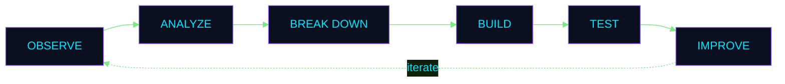

<!-- ============================================================
  GITHUB PROFILE README  |  NerdBhattarai98
  Palette: navy #0B1020 | cyan #00E5FF | violet #8B5CF6 | lime #7EE787
  Placeholders appear as [square brackets]. Search for "[" to find them.
============================================================ -->

<!-- ========== HERO ========== -->
<div align="center">


<br/>

<!-- Terminal-style introduction. Edit the text inside the code block. -->
<table>
  <tr>
    <td>

```bash
$ whoami
  Developer | Problem Solver | Lifelong Learner

$ cat interests.txt
  Programming . Data Analysis . Web Development . Mobile Apps

$ echo $MISSION
  Turning ideas into working software, one commit at a time.
```

</td>
  </tr>
</table>

<!-- Status badges: keep to three or four -->


<br/><br/>

<!-- Navigation: each link points to a real section heading below -->
<a href="#tech-stack"></a>
<a href="#problem-solving-engine"></a>
<a href="#featured-projects"></a>
<a href="#github-activity"></a>
<a href="#contact"></a>

</div>

<br/>


<!-- ========== ABOUT ========== -->
<div align="center">

<sub><code>MODULE 00 // ABOUT</code></sub>

## About

</div>

I am a developer who enjoys understanding why a solution works, not only that it works. Programming is how I solve problems, data analysis is how I find patterns, and web and mobile development are how I put that work in front of real users.

I learn by building. Each project is a chance to apply a concept, find where my understanding is incomplete, and improve the next version.

<!-- EDIT: one sentence on your direction, for example the type of work or role you are aiming for -->
**Current direction:** [One sentence describing what you are working toward]


<!-- ========== TECH STACK ========== -->
<div align="center">

<sub><code>MODULE 01 // SKILLS</code></sub>

## Tech Stack

</div>

<!--
  Icons: skillicons.dev. Valid ids used here: py, c, cpp, cs, js, numpy, pandas, matplotlib, html, css, flutter, git, github.
  Seaborn has no skillicons.dev icon, so a shields.io badge is used.
  JavaScript appears once (Languages) and is referenced in the Web row.
  If an icon fails to load, its alt text keeps the technology name visible.
-->

<table>
  <tr>
    <td width="230"><b><code>Languages</code></b></td>
    <td></td>
  </tr>
  <tr>
    <td><b><code>Data and Visualization</code></b></td>
    <td>
      
      
    </td>
  </tr>
  <tr>
    <td><b><code>Web</code></b></td>
    <td>
      
      <sub>&nbsp;plus JavaScript (above)</sub>
    </td>
  </tr>
  <tr>
    <td><b><code>Mobile</code></b></td>
    <td></td>
  </tr>
  <tr>
    <td><b><code>Tools</code></b></td>
    <td></td>
  </tr>
  <tr>
    <td><b><code>Core Strengths</code></b></td>
    <td>
      <code>analytical thinking</code>
      <code>logical reasoning</code>
      <code>problem-solving</code>
      <code>programming</code>
      <code>data exploration</code>
    </td>
  </tr>
</table>

<div align="center">
<sub><i>These are the technologies I work with and am still developing. This is not a ranking of proficiency.</i></sub>
</div>


<!-- ========== PROBLEM SOLVING ========== -->
<div align="center">

<sub><code>MODULE 02 // APPROACH</code></sub>

## Problem-Solving Engine

</div>



<table>
  <tr>
    <td width="50%" valign="top">
      <h4>Analytical thinking, applied to data</h4>
      <p>Data rarely explains itself. I explore it with Pandas and NumPy, summarize it, and use Seaborn and Matplotlib to make patterns visible before drawing conclusions.</p>
    </td>
    <td width="50%" valign="top">
      <h4>Logical reasoning, applied to code</h4>
      <p>Programs follow rules. In Python, C, C++, and C#, I trace how data moves and where conditions branch, so I can explain why a program produces its result, and fix it when it does not.</p>
    </td>
  </tr>
</table>

<table>
  <tr>
    <td>

```text
# how I handle a bug
error  -> read the message, reproduce the failure
cause  -> find the root cause, not the symptom
fix    -> change one thing, then re-test
learn  -> note the lesson, apply it to the next solution
```

</td>
  </tr>
</table>


<!-- ========== PROJECTS ========== -->
<div align="center">

<sub><code>MODULE 03 // PROJECTS</code></sub>

## Featured Projects

</div>

<!--
  HOW TO EDIT THIS SECTION
  1. Descriptions below come from your repository text. Replace [bracketed placeholders] with real details.
  2. To add a screenshot: upload the image to a repository folder (for example assets/) and use
       
  3. To feature a different project as the flagship, swap the repo name in the pin-card URL and the table.
  4. Pin cards come from GitHub Readme Stats. If one does not load, delete the card; the table below it still works.
-->

<!-- ---------- FLAGSHIP ---------- -->
<div align="center">

<sub><code>FLAGSHIP</code></sub>

<a href="https://github.com/NerdBhattarai98/Smart-File-Organizer"></a>

</div>

<table>
  <tr>
    <td width="170" valign="top"><b><code>Problem</code></b></td>
    <td>Messy folders and duplicate files take up space and time to clean up by hand.</td>
  </tr>
  <tr>
    <td valign="top"><b><code>What it does</code></b></td>
    <td>A full-stack app that monitors directories, sorts files according to user-defined rules, and deletes duplicates to free up space.</td>
  </tr>
  <tr>
    <td valign="top"><b><code>Features</code></b></td>
    <td>Directory monitoring<br/>Rule-based file sorting<br/>Duplicate removal<br/>Action logging<br/>[Add any other feature]</td>
  </tr>
  <tr>
    <td valign="top"><b><code>Technologies</code></b></td>
    <td>Python<br/>[Add frameworks or libraries used]</td>
  </tr>
  <tr>
    <td valign="top"><b><code>Challenge / lesson</code></b></td>
    <td>[Describe one technical challenge you solved or a design decision you made, and what it taught you]</td>
  </tr>
  <tr>
    <td valign="top"><b><code>Screenshot</code></b></td>
    <td>[Add a screenshot, or delete this row]</td>
  </tr>
  <tr>
    <td valign="top"><b><code>Links</code></b></td>
    <td><a href="https://github.com/NerdBhattarai98/Smart-File-Organizer">Repository</a> &nbsp;|&nbsp; [Live demo, if applicable]</td>
  </tr>
</table>

<br/>

<!-- ---------- SUPPORTING PROJECTS ---------- -->
<table>
  <tr>
    <td width="50%" valign="top" align="center">
      <a href="https://github.com/NerdBhattarai98/Book-Recommendation-System"></a>
    </td>
    <td width="50%" valign="top" align="center">
      <a href="https://github.com/NerdBhattarai98/FlutterProject_1-"></a>
    </td>
  </tr>
  <tr>
    <td width="50%" valign="top">
      <b><code>Book Recommendation System</code></b><br/><br/>
      <b>Problem:</b> Readers need help finding books that match their interests.<br/>
      <b>What it does:</b> Suggests books based on a user's interests, reading history, ratings, and preferences.<br/>
      <b>Technologies:</b> Python, [add libraries used]<br/>
      <b>Approach:</b> [Which recommendation technique did you use?]<br/>
      <b>Challenge / lesson:</b> [Add one specific lesson]<br/>
      <b>Links:</b> <a href="https://github.com/NerdBhattarai98/Book-Recommendation-System">Repository</a> | [Demo or screenshot]
    </td>
    <td width="50%" valign="top">
      <b><code>Flutter Task Manager</code></b><br/><br/>
      <b>Problem:</b> Daily tasks are easy to lose track of without a simple tool.<br/>
      <b>What it does:</b> A mobile task management app with a clean, intuitive interface for creating, managing, and tracking daily tasks.<br/>
      <b>Technologies:</b> Flutter, Dart<br/>
      <b>Features:</b> [Add key features, for example local storage if used]<br/>
      <b>Challenge / lesson:</b> [Add one specific lesson]<br/>
      <b>Links:</b> <a href="https://github.com/NerdBhattarai98/FlutterProject_1-">Repository</a> | [Demo or screenshot]
    </td>
  </tr>
</table>

<br/>

<!-- ---------- LEARNING AND PRACTICE REPOSITORIES ---------- -->
<div align="center">

<sub><code>LEARNING AND PRACTICE REPOSITORIES</code></sub>

</div>

<table>
  <tr>
    <td><b><code>Repository</code></b></td>
    <td><b><code>Contents</code></b></td>
    <td><b><code>Tech</code></b></td>
  </tr>
  <tr>
    <td><a href="https://github.com/NerdBhattarai98/Data_Analysis_Projects">Data_Analysis_Projects</a></td>
    <td>Exploratory data analysis (EDA) and data analysis projects from my learning.</td>
    <td>Jupyter Notebook</td>
  </tr>
  <tr>
    <td><a href="https://github.com/NerdBhattarai98/Pandas-for-AI-ML">Pandas-for-AI-ML</a></td>
    <td>Code I practiced while learning Pandas.</td>
    <td>Jupyter Notebook</td>
  </tr>
  <tr>
    <td><a href="https://github.com/NerdBhattarai98/Numpy-for-AI-ML">Numpy-for-AI-ML</a></td>
    <td>Code I practiced while learning NumPy, plus a few projects.</td>
    <td>Python</td>
  </tr>
</table>


<!-- ========== CURRENTLY BUILDING + ROADMAP ========== -->
<div align="center">

<sub><code>MODULE 04 // PROGRESS</code></sub>

## Currently Building

</div>

<!-- EDIT: replace the bracketed values whenever your focus changes -->
<table>
  <tr>
    <td>

```text
$ git status
  building   : [project name or topic]
  next goal  : [what you want to finish next]
  learning   : [concept or tool]
```

</td>
  </tr>
</table>

<div align="center">

### Learning Roadmap

</div>

<table>
  <tr>
    <td><b><code>Stage</code></b></td>
    <td><b><code>Focus</code></b></td>
    <td><b><code>Work</code></b></td>
  </tr>
  <tr>
    <td>01 Data foundations</td>
    <td>NumPy and Pandas</td>
    <td><a href="https://github.com/NerdBhattarai98/Numpy-for-AI-ML">Numpy-for-AI-ML</a>, <a href="https://github.com/NerdBhattarai98/Pandas-for-AI-ML">Pandas-for-AI-ML</a></td>
  </tr>
  <tr>
    <td>02 Applied analysis</td>
    <td>Exploratory data analysis</td>
    <td><a href="https://github.com/NerdBhattarai98/Data_Analysis_Projects">Data_Analysis_Projects</a></td>
  </tr>
  <tr>
    <td>03 Applications</td>
    <td>Python tools and a Flutter mobile app</td>
    <td><a href="https://github.com/NerdBhattarai98/Smart-File-Organizer">Smart-File-Organizer</a>, <a href="https://github.com/NerdBhattarai98/Book-Recommendation-System">Book-Recommendation-System</a>, <a href="https://github.com/NerdBhattarai98/FlutterProject_1-">FlutterProject_1-</a></td>
  </tr>
  <tr>
    <td>04 Next</td>
    <td>[What you plan to learn next]</td>
    <td>[Planned project, or delete this row]</td>
  </tr>
</table>


<!-- ========== GITHUB ACTIVITY (OPTIONAL) ========== -->
<div align="center">

<sub><code>MODULE 05 // ACTIVITY</code></sub>

## GitHub Activity

</div>

<!--
  OPTIONAL: delete this whole section if you prefer not to show statistics.
  All cards come from third-party services. If one is slow or down, GitHub shows its alt text,
  and the rest of the README is unaffected.
-->

<div align="center">

<table>
  <tr>
    <td width="50%" align="center">
      
    </td>
    <td width="50%" align="center">
      
    </td>
  </tr>
</table>


<sub><i>Language statistics reflect the contents of my repositories, not proficiency in any language.</i></sub>

</div>


<!-- ========== CONTACT ========== -->
<div align="center">

<sub><code>MODULE 06 // CONTACT</code></sub>

## Contact

I welcome conversations about internships, entry-level opportunities, and project collaboration.

<br/>

<!--
  Portfolio badge is intentionally omitted until you have a URL. When you do, add:
  <a href="YOUR_PORTFOLIO_URL"></a>
-->

<a href="https://www.linkedin.com/in/anbit-bhattarai-518377370"></a>
<a href="mailto:anbitbhattarai2005@gmail.com"></a>
<a href="https://github.com/NerdBhattarai98?tab=repositories"></a>
<a href="https://github.com/Arixon-Technology"></a>

</div>

<br/>

<!-- ========== FOOTER ========== -->
<div align="center">


</div>
