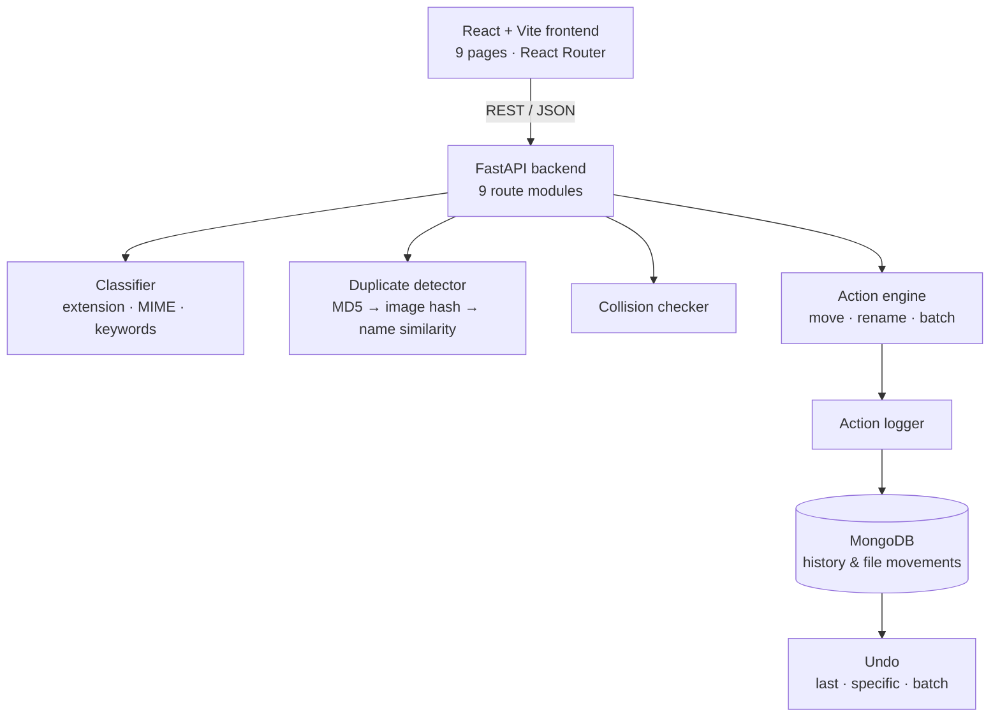
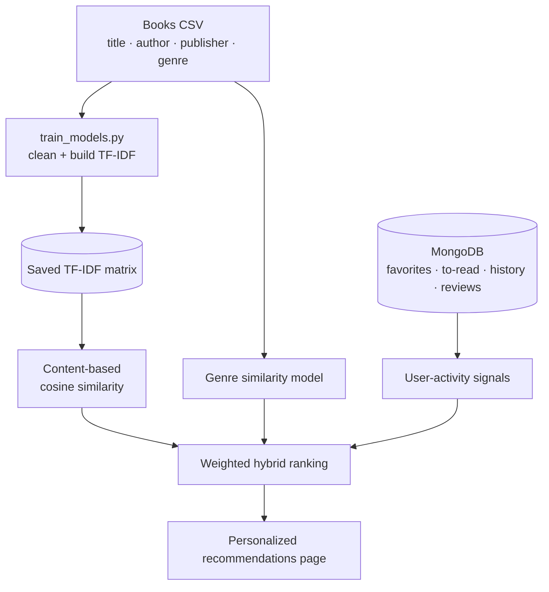

<!--
  GitHub profile README · NerdBhattarai98
  Palette: navy #0B1020 · cyan #00E5FF · violet #8B5CF6 · lime #7EE787 · soft white #E6F1FF · gray #8B949E

  Maintenance guide
  - "Currently Building": edit the four lines in the text block whenever your focus changes.
  - "Roadmap": move a stage from ○ to ▸ to ✓ as you finish it.
  - "GitHub Activity": optional; delete the whole section if the cards stop loading.
  Every claim in this file is based on code in the linked repositories. Keep it that way.
-->

<div align="center">


<br/>


<br/><br/>

<b>
<a href="#recruiter-snapshot">Snapshot</a> ·
<a href="#why-work-with-me">Why me</a> ·
<a href="#about">About</a> ·
<a href="#tech-stack">Stack</a> ·
<a href="#featured-projects">Projects</a> ·
<a href="#engineering-habits">Habits</a> ·
<a href="#currently-building">Now</a> ·
<a href="#roadmap">Roadmap</a> ·
<a href="#contact">Contact</a>
</b>

</div>

<br/>

## Recruiter Snapshot

> **30-second summary:** CS student who has built two working full-stack Python applications (FastAPI + React, Flask + scikit-learn), a Flutter mobile app, and a structured data-analysis portfolio. Looking for an internship or entry-level role in **software development, data analysis, or ML engineering**.

| | |
| --- | --- |
| **Looking for** | Software development, data analyst, or junior AI/ML internships and entry-level roles |
| **Strongest skills** | Python · Pandas / NumPy · FastAPI & Flask backends · React frontends · exploratory data analysis |
| **Best project to review** | [Smart File Organizer](#smart-file-organizer): 19 API endpoints, React UI, MongoDB action log, full undo |
| **ML evidence** | [Book Recommendation System](#book-recommendation-system): TF-IDF + cosine similarity hybrid recommender with tests |
| **Data evidence** | [Data Analysis Portfolio](#data-analysis-portfolio): 8-step EDA workflow across five real datasets |
| **Location** | Nepal · UTC+05:45 |
| **Reach me** | [LinkedIn](https://www.linkedin.com/in/anbit-bhattarai-518377370) · [anbitbhattarai2005@gmail.com](mailto:anbitbhattarai2005@gmail.com) |

<br/>

## Why Work With Me

Every point below links to code you can check.

- **I build complete applications, not just scripts.** My file organizer has a React frontend, a FastAPI backend split into nine route modules, and a MongoDB history log, all wired together. → [Smart-File-Organizer](https://github.com/NerdBhattarai98/Smart-File-Organizer)
- **I think about what can go wrong.** That same app makes every file move reversible (undo last, undo one, undo a batch), checks for name collisions before moving, and only accepts requests from localhost because it touches the file system.
- **I match the algorithm to the data.** When my book dataset turned out to have no per-user ratings, I didn't fake collaborative filtering. I combined TF-IDF content similarity, genre similarity, and live user activity instead. → [Book-Recommendation-System](https://github.com/NerdBhattarai98/Book-Recommendation-System)
- **I care about performance where it matters.** The recommender precomputes its TF-IDF matrix in a separate training script so the web app starts fast; the file organizer hashes files in 64 KB chunks and skips files over 500 MB.
- **I'm disciplined with data.** My EDA projects follow written rules: log every cleaning decision, apply minimum sample sizes before ranking, and never present correlation as causation. → [Data_Analysis_Projects](https://github.com/NerdBhattarai98/Data_Analysis_Projects)
- **I learn fundamentals properly.** Before touching ML libraries, I worked through NumPy (broadcasting, views vs copies, linear algebra) and Pandas (cleaning, merging, aggregation) module by module, with cheat sheets. → [NumPy](https://github.com/NerdBhattarai98/Numpy-for-AI-ML) · [Pandas](https://github.com/NerdBhattarai98/Pandas-for-AI-ML)
- **I work across the stack and across platforms.** Python backends, React and Jinja frontends, MongoDB and SQLite storage, and a Flutter app for mobile.

<br/>

## About

I'm a computer science student who likes problems that can be taken apart and solved with code. Most of my work is in **Python**: I analyse data with Pandas, NumPy, Matplotlib and Seaborn, and I've built two full-stack Python applications, a file organizer and a book recommender.

Right now I'm moving from data analysis toward **machine learning**, and from individual projects toward **production-quality full-stack development**: proper testing, deployment, and relational databases.

I learn by implementing things myself, breaking them, and finding out *why* they broke. If I can't explain how a solution works, I don't consider it finished.

**What I'm focused on**

| Area | Using now | Learning next |
| --- | --- | --- |
| **AI/ML & data** | NumPy, Pandas, Matplotlib, Seaborn, EDA, TF-IDF and cosine similarity with scikit-learn | Statistics, SQL, supervised ML models, evaluation |
| **Software development** | Python, C, C++, C#, Git, debugging, REST API design | Automated testing, CI, cleaner project structure |
| **Web & apps** | HTML, CSS, JavaScript, React, FastAPI, Flask, MongoDB, Flutter | Next.js, Django, PostgreSQL/MySQL, deployment |

<br/>

## Tech Stack

<!-- Icons: skillicons.dev (ids checked against the skill-icons source). Data libraries have no skillicons icon, so they use text badges. -->

**Languages**<br/>
<br/>
<sub>Python · C · C++ · C# · JavaScript · Dart</sub>

**Data analysis & machine learning**<br/>


**Backend & databases**<br/>
<br/>
<sub>FastAPI · Flask · MongoDB · SQLite</sub>

**Frontend & mobile**<br/>
<br/>
<sub>HTML · CSS · React · Vite · Flutter</sub>

**Tools**<br/>
<br/>
<sub>Git · GitHub · VS Code</sub>

**Currently learning:** <code>Statistics</code> <code>SQL</code> <code>Supervised ML</code> <code>Next.js</code> <code>Django</code> <code>Testing & CI</code>

### Skill → Evidence

| Skill | Where you can see it |
| --- | --- |
| REST API design (FastAPI) | [Smart File Organizer](https://github.com/NerdBhattarai98/Smart-File-Organizer): 19 endpoints across scan, classify, duplicates, collisions, actions, undo, history, movements, DB sync |
| React frontend | [Smart File Organizer](https://github.com/NerdBhattarai98/Smart-File-Organizer): 9 pages, 11 components, React Router, API service layer |
| Server-rendered web app (Flask) | [Book Recommendation System](https://github.com/NerdBhattarai98/Book-Recommendation-System): auth, browsing, search, favorites, reviews, recommendations |
| Applied ML / information retrieval | [Book Recommendation System](https://github.com/NerdBhattarai98/Book-Recommendation-System): TF-IDF (1–2-grams, 8,000 features), cosine similarity, weighted hybrid |
| Automated tests | [Book Recommendation System](https://github.com/NerdBhattarai98/Book-Recommendation-System): 14 tests across auth, books, and both recommenders |
| NoSQL and SQL storage | MongoDB in both Python apps; SQLite via `sqflite` in the [Flutter app](https://github.com/NerdBhattarai98/FlutterProject_1-) |
| Data cleaning & EDA | [Data_Analysis_Projects](https://github.com/NerdBhattarai98/Data_Analysis_Projects): documented 8-step workflow and project standards |
| Numerical computing | [Numpy-for-AI-ML](https://github.com/NerdBhattarai98/Numpy-for-AI-ML): broadcasting, vectorization, standardization, softmax, linear algebra |
| Mobile development | [FlutterProject_1-](https://github.com/NerdBhattarai98/FlutterProject_1-): stateful UI, tabs, dialogs, local persistence |

<sub><i>Listed technologies are ones I've used in my own code. That isn't the same as equal mastery of all of them.</i></sub>

<br/>

## Featured Projects

<!--
  No screenshots exist in these repositories yet. To add one:
  1. Put the image in the project repo, e.g. docs/screenshot.png
  2. Paste this under the project's heading:
     
-->

| Project | Type | Stack | Status |
| --- | --- | --- | --- |
| [Smart File Organizer](#smart-file-organizer) | Full-stack app | FastAPI · React · MongoDB | Working locally |
| [Book Recommendation System](#book-recommendation-system) | ML web app | Flask · scikit-learn · MongoDB | Working locally, tested |
| [Flutter Todo App](#flutter-todo-app) | Mobile app | Flutter · Dart · SQLite | Complete |
| [Data Analysis Portfolio](#data-analysis-portfolio) | EDA portfolio | Pandas · NumPy · Seaborn | In progress |

### Smart File Organizer


**A full-stack tool that scans a folder, sorts files into categories, finds duplicates, and can undo everything it moved.**

**The problem:** download and project folders fill up with unsorted files, duplicate copies, and meaningless names like `IMG_8812 (1).jpg`. Cleaning them by hand is slow, and automated tools that move files without a way back are risky.

**Architecture**



**What I built**

- **Frontend:** React 18 with Vite and React Router: home, dashboard, organize, processing, classification, duplicates, batch operations, history and settings pages, plus modals for collisions, renaming and customization.
- **Backend:** FastAPI with 19 endpoints grouped into scan, classify, detect duplicates, collisions, apply action (single and batch), undo, history and stats, file-movement history, and database sync and verification.
- **Classification:** rule-based, layered from most to least reliable: extension map, then MIME type, then filename keywords.
- **Duplicate detection, from most to least certain:**
  1. MD5 content hash in 64 KB chunks for exact copies (files over 500 MB are skipped).
  2. An 8×8 grayscale average hash with Pillow for visually identical images.
  3. Filename similarity for likely near-duplicates.
- **Safety:** checks for name collisions at the destination before moving, logs every action, and supports undo of the last action, a specific action, or a whole batch.
- **Extras:** detects random-looking filenames and suggests readable names; full history of where each file has been moved.

<details>
<summary><b>Code highlight: image hashing for duplicate detection</b></summary>
<br/>

From `backend/app/ml/duplicate_detector.py`: shrink the image to 8×8 grayscale, then record whether each pixel is brighter than the average. Two visually identical images produce the same 64-bit hash even if their file bytes differ.

```python
img = self.Image.open(file_path)
img = img.resize((8, 8), self.Image.Resampling.LANCZOS)
img = img.convert('L')                      # grayscale

pixels = list(img.getdata())
avg = sum(pixels) / len(pixels)
hash_bits = ''.join('1' if p > avg else '0' for p in pixels)
return hex(int(hash_bits, 2))[2:].zfill(16)
```

</details>

**Key decisions**

| Decision | Why |
| --- | --- |
| Reversible actions with a MongoDB log | File operations are destructive; users need a way back |
| Exact hash before perceptual hash before filename match | Run the most certain check first, so weaker checks only handle what's left |
| API restricted to localhost (CORS + trusted hosts) | The API can move files on disk, so it must not be reachable from other machines |
| Rule-based classification instead of a trained model | Extensions and MIME types are reliable signals; a model wasn't needed for this step |

**Next improvements:** broader automated tests, packaging for one-command setup, and a hosted demo with sample files.

**Stack:** `Python` `FastAPI` `Pydantic` `MongoDB` `Pillow` `React 18` `React Router` `Vite`

**Code:** [NerdBhattarai98/Smart-File-Organizer](https://github.com/NerdBhattarai98/Smart-File-Organizer)

---

### Book Recommendation System


**A Flask web app that recommends books based on a user's favorites, to-read list, reading history and searches.**

**The problem:** readers with a large catalogue in front of them need help finding books close to what they already like, and recommendations should improve as they use the app.

**Recommendation pipeline**



**What I built**

- **Web app:** Flask blueprints for auth (register, login, logout, profile), books (browse, search, details), user lists (favorites, to-read, history, searches, reviews) and recommendations, rendered with Jinja templates, HTML, CSS and JavaScript.
- **Content-based filtering:** TF-IDF vectorization (English stop words, unigrams and bigrams, 8,000 features) and cosine similarity between books.
- **Hybrid ranking:** blends content similarity, genre similarity, and real-time signals from other users' activity, with a configurable content weight.
- **Personalization:** combines favorites, to-read, history and searches into one recommendation set, and finds books liked by users with similar activity.
- **Performance:** `train_models.py` precomputes and saves the TF-IDF matrix so the app doesn't rebuild it at every startup.
- **Testing:** 14 tests across four modules: auth, books, content-based filtering, and the similarity-based filtering.

**Challenge and lesson:** the dataset has ratings per book, not per user, so classic user-based collaborative filtering wasn't possible from it. Instead of pretending, I used genre similarity plus live in-app activity as the collaborative signal. *Lesson: check what the data can support before choosing the algorithm.*

**Next improvements:** an offline evaluation (precision@k on held-out favorites) and true collaborative filtering once enough user interactions exist.

**Stack:** `Python` `Flask` `scikit-learn` `Pandas` `NumPy` `SciPy` `MongoDB` `Jinja` `JavaScript`

**Code:** [NerdBhattarai98/Book-Recommendation-System](https://github.com/NerdBhattarai98/Book-Recommendation-System)

---

### Flutter Todo App


**A cross-platform task manager, and my first Flutter project.**

- Add, edit, complete and delete tasks, with a confirmation step before deleting.
- Separate **Pending** and **Completed** tabs, with expandable task descriptions.
- Tasks persist on the device in **SQLite** through `sqflite`, behind a small singleton database class.

<details>
<summary><b>Data model</b></summary>
<br/>

```sql
CREATE TABLE tasks(
  id          INTEGER PRIMARY KEY AUTOINCREMENT,
  title       TEXT NOT NULL,
  description TEXT,
  isDone      INTEGER NOT NULL
)
```

</details>

**Stack:** `Flutter` `Dart` `sqflite` `google_fonts`

**Code:** [NerdBhattarai98/FlutterProject_1-](https://github.com/NerdBhattarai98/FlutterProject_1-)

---

### Data Analysis Portfolio


**Five real datasets, one consistent 8-step EDA workflow, and findings that only claim what the numbers support.**

| # | Dataset | Main question | Progress |
| --- | --- | --- | --- |
| 1 | Spotify Tracks | What audio profile do popular tracks and genres share? | Steps 1–4 done |
| 2 | Netflix Titles | How has the catalogue changed over time? | Planned |
| 3 | Formula 1 | How much does grid position relate to the result? | Planned |
| 4 | International Football | How large is home advantage, and how has scoring changed? | Planned |
| 5 | World Happiness 2019 | Which indicators are most associated with happiness? | Planned |

**Workflow:** define the question → load and inspect → clean → univariate analysis and outliers → bivariate → multivariate → time and segments → summarize findings.

**Standards I hold myself to:**
- Every cleaning decision (missing values, duplicates, invalid values) is logged with a reason.
- Rankings use minimum sample sizes, so small groups don't dominate.
- Outliers are investigated before they're removed.
- Correlation is never presented as causation.
- Every chart has a title and labelled axes with units.

**Code:** [NerdBhattarai98/Data_Analysis_Projects](https://github.com/NerdBhattarai98/Data_Analysis_Projects)

---

### Learning Repositories

| Repository | What's inside |
| --- | --- |
| [Numpy-for-AI-ML](https://github.com/NerdBhattarai98/Numpy-for-AI-ML) | Six modules with practice files and cheat sheets: array foundations, indexing (including views vs copies), manipulation, vectorization and broadcasting (standardization, softmax), linear algebra, random numbers and statistics |
| [Pandas-for-AI-ML](https://github.com/NerdBhattarai98/Pandas-for-AI-ML) | Series, DataFrames, importing, selection, filtering, aggregation, data cleaning, and merge/concat/join |

<br/>

## Engineering Habits

What I already do in my projects, and what I'm adding next.

| Habit | Where it shows up |
| --- | --- |
| **Make destructive actions reversible** | Undo system and action log in Smart File Organizer |
| **Fail safely** | Hashing errors are logged and skipped instead of crashing a scan; large files are skipped on purpose |
| **Restrict access by default** | Localhost-only CORS and trusted hosts on an API that touches the file system |
| **Separate slow work from request time** | Offline TF-IDF training script in the recommender |
| **Structure code by responsibility** | Route modules, services, models and ML components kept in separate packages |
| **Write tests for core logic** | 14 tests in the recommender; *expanding test coverage across all projects is my next habit to build* |
| **Document decisions, not just code** | Cleaning logs and stated limitations in every EDA project |

<br/>

## Currently Building

<!-- Edit these four lines when your focus changes. -->

```text
$ git status
  focus      : Python data analysis → practical machine learning
  project    : Spotify Tracks EDA (Data_Analysis_Projects, project 1 of 5)
  next       : steps 5–8: bivariate and multivariate analysis, written findings
  learning   : statistics and SQL foundations before scikit-learn models
```

<br/>

## Roadmap

`✓` done &nbsp; `▸` in progress &nbsp; `○` planned

### AI/ML

| | Stage | Proof of completion |
| --- | --- | --- |
| `✓` | NumPy, Pandas, Matplotlib, Seaborn | [NumPy](https://github.com/NerdBhattarai98/Numpy-for-AI-ML) and [Pandas](https://github.com/NerdBhattarai98/Pandas-for-AI-ML) repos |
| `✓` | Applied similarity-based ML | TF-IDF recommender |
| `▸` | Exploratory data analysis | [Five-dataset EDA portfolio](https://github.com/NerdBhattarai98/Data_Analysis_Projects) |
| `○` | Statistics, probability & SQL | Analysis notebooks with hypothesis tests and SQL queries |
| `○` | Core ML & evaluation | A supervised model with proper train/test splits and metrics |
| `○` | Feature engineering, leakage prevention, error analysis | A documented error-analysis write-up |
| `○` | Deep learning fundamentals | A small neural network project |
| `○` | Model APIs & deployment | A model served behind a FastAPI endpoint, deployed |
| `○` | LLM apps, retrieval & evaluation | A retrieval-based app with an evaluation set |
| `○` | Reproducible workflows, testing & MLOps basics | Tests and CI on an ML project |

### Full-stack

| | Stage | Proof of completion |
| --- | --- | --- |
| `✓` | HTML, CSS, REST APIs with FastAPI and Flask | Both Python apps |
| `✓` | React basics | Smart File Organizer frontend |
| `▸` | JavaScript fundamentals | Ongoing practice projects |
| `○` | React in depth & Next.js | A Next.js app |
| `○` | Django & relational database design | A Django + SQL project |
| `○` | Testing, Git workflow & deployment | A deployed app with tests and CI |
| `○` | Full-stack apps with data or AI features | A deployed full-stack project that uses a model |

<br/>

## How I Solve Problems

**Observe → Understand → Break down → Implement → Test → Improve**

```text
# when something breaks
reproduce  → make the failure happen on purpose
read       → the full error message, not just the last line
cause      → find the root cause, not the symptom
fix        → change one thing, then re-test
record     → write down the lesson if it will come back
```

- **In code:** I trace how data moves and where conditions branch until I can explain the output, then fix the cause rather than the symptom.
- **In data analysis:** I inspect and clean before plotting, check sample sizes, and treat every finding as a hypothesis until the numbers support it.
- **In design:** I ask what happens when something goes wrong (a duplicate name, a huge file, a missing rating) and build the answer into the system.

<br/>

## What I Bring to a Team

- **Ownership:** I've taken projects from idea to a working multi-part system on my own: frontend, backend, database, and ML.
- **Honesty about limits:** I document what my projects *don't* do yet, and I'll say "I don't know, I'll find out" rather than guess.
- **Learning speed with depth:** I learn by building, and I go back to fundamentals when something doesn't make sense.
- **Communication:** I write READMEs, cleaning logs and decision tables so the next person, or a reviewer, can follow my reasoning.

<br/>

## GitHub Activity

<!-- Optional: these cards come from third-party services. Delete this section if they become unreliable; nothing else depends on it. -->

<div align="center">


<sub><i>Language shares are file sizes in public repos, not skill levels. Flutter's generated platform code counts as C++.</i></sub>

</div>

<details>
<summary><b>Contribution graph</b></summary>
<br/>

</details>

<br/>

## Contact

I'm open to **internships, entry-level roles, technical projects and collaboration**. If you're hiring for Python, data, or full-stack work, I'd be glad to walk you through any project above, including the parts I'd build differently now.

<a href="https://www.linkedin.com/in/anbit-bhattarai-518377370"></a>
<a href="mailto:anbitbhattarai2005@gmail.com"></a>
<a href="https://github.com/NerdBhattarai98?tab=repositories"></a>
<a href="https://github.com/Arixon-Technology"></a>

<sub>Text links: [LinkedIn](https://www.linkedin.com/in/anbit-bhattarai-518377370) · [anbitbhattarai2005@gmail.com](mailto:anbitbhattarai2005@gmail.com) · [Repositories](https://github.com/NerdBhattarai98?tab=repositories) · [Arixon-Technology](https://github.com/Arixon-Technology)</sub>

<br/>

<div align="center">

<code>while (learning) { build(); test(); improve(); }</code>


</div>
